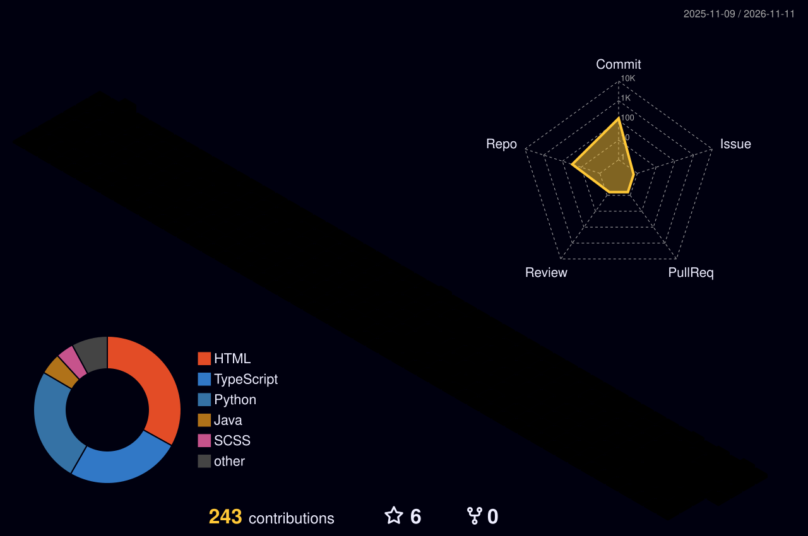

<!-- ========================= HEADER ========================= -->
<p align="center">
  
</p>

<p align="center">
  <a href="https://git.io/typing-svg">
    
  </a>
</p>

<p align="center">
  
  <a href="https://github.com/eliepethuel?tab=followers"></a>
  <a href="mailto:pethuelelie@gmail.com"></a>
</p>

---

##  À propos de moi


```python
class Elie:
    def __init__(self):
        self.role      = "Étudiant L3 Génie Logiciel"
        self.location  = "Abidjan, Côte d'Ivoire 🇨🇮"
        self.focus     = ["Web Full-Stack", "Mobile", "Data & Automatisation"]
        self.stack     = {
            "backend":  ["Python", "Django", "Flask", "Java"],
            "frontend": ["Angular", "React", "TypeScript", "Tailwind"],
            "cloud":    ["Supabase", "PostgreSQL"],
            "mobile":   ["Flutter", "Dart"],
            "erp":      ["Odoo"],
        }
        self.learning  = ["Tests & validation logiciel", "DevOps", "IA appliquée"]
        self.fun_fact  = "Je transforme les problèmes du quotidien en apps 💡"

    def say_hi(self):
        print("Merci de passer par ici ! N'hésite pas à collaborer 🤝")
```

<br clear="right"/>

---

## 🛠️ Ma stack technique

<p align="center">
  <a href="https://skillicons.dev">
    
  </a>
  <br/><br/>
  <a href="https://skillicons.dev">
    
  </a>
</p>

---

## 🚀 Projets phares

<p align="center">
  <a href="https://github.com/eliepethuel/kanivo">
    
  </a>
  <a href="https://github.com/eliepethuel/GREENGAS_COMPLET">
    
  </a>
  <a href="https://github.com/eliepethuel/Agrimarket_ci">
    
  </a>
  <a href="https://github.com/eliepethuel/Log-compta-pro">
    
  </a>
  <a href="https://github.com/eliepethuel/COFINANCE_CI">
    
  </a>
  <a href="https://github.com/eliepethuel/it_parc">
    
  </a>
</p>

| Projet | Ce que c'est | Stack |
|---|---|---|
| 🌊 **[Kanivo](https://github.com/eliepethuel/kanivo)** · [**🔗 Démo live**](https://eliepethuel.github.io/kanivo/) | Plateforme citoyenne et prédictive contre les inondations à Abidjan, avec simulateur interactif — Lighthouse **100/100** desktop | Vite · JavaScript · GSAP · Canvas |
| 🌿 **[GreenGas](https://github.com/eliepethuel/GREENGAS_COMPLET)** | Hackathon SIREXE 2026 : tri des déchets organiques → biogaz, électricité et digestat. 3 applis connectées (API, Control Center, mobile) | Django REST · JWT · React · Flutter |
| 🌾 **[AgriMarket CI](https://github.com/eliepethuel/Agrimarket_ci)** | Marketplace agricole producteurs / acheteurs / livreurs avec supervision admin, 45 fichiers de tests | Angular 21 · Signals · TypeScript strict |
| 📊 **[ComptaVision Pro](https://github.com/eliepethuel/Log-compta-pro)** | Comptabilité pour PME : tableau de bord, trésorerie, journal, exports PDF/Excel, rôles | React 19 · TanStack Start · Supabase (RLS) |
| 🏦 **[Cofinance CI](https://github.com/eliepethuel/COFINANCE_CI)** | Microfinance : microcrédits, assurances, remboursements et chat en temps réel | Django REST · WebSockets · PostgreSQL |
| 🖥️ **[IT Parc](https://github.com/eliepethuel/it_parc)** | Module ERP de gestion du parc informatique : affectations, maintenances, contrats, alertes, dashboard | Odoo 18 · Python · OWL |

---

## 📊 Statistiques GitHub

<p align="center">
  
  
</p>

<p align="center">
  
</p>

---

## 🧊 Mes contributions en 3D

<p align="center">
  <picture>
    <source media="(prefers-color-scheme: dark)" srcset="./profile-3d-contrib/profile-night-rainbow.svg" />
    <source media="(prefers-color-scheme: light)" srcset="./profile-3d-contrib/profile-green-animate.svg" />
    
  </picture>
</p>

---

## ⚡ Activité récente

<!--START_SECTION:activity-->
<!--END_SECTION:activity-->

---

## 🐍 Mes contributions se font dévorer

<p align="center">
  <picture>
    <source media="(prefers-color-scheme: dark)" srcset="https://raw.githubusercontent.com/eliepethuel/eliepethuel/output/github-snake-dark.svg" />
    <source media="(prefers-color-scheme: light)" srcset="https://raw.githubusercontent.com/eliepethuel/eliepethuel/output/github-snake.svg" />
    
  </picture>
</p>

---

## 🤝 Me contacter

<p align="center">
  <a href="mailto:pethuelelie@gmail.com"></a>
  <a href="https://github.com/eliepethuel/PORTFOLIO"></a>
  <!-- Décommente et remplace par ton lien LinkedIn :
  <a href="https://www.linkedin.com/in/TON-PROFIL"></a>
  -->
</p>

<p align="center">
  
</p>

<!-- ========================= FOOTER ========================= -->
<p align="center">
  
</p>
